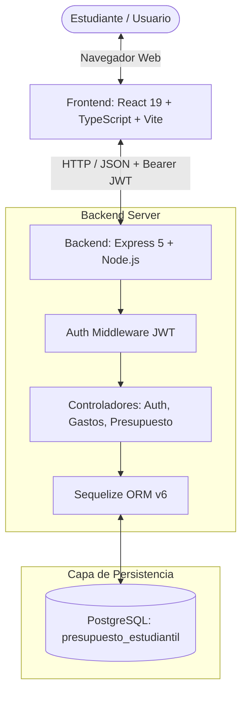
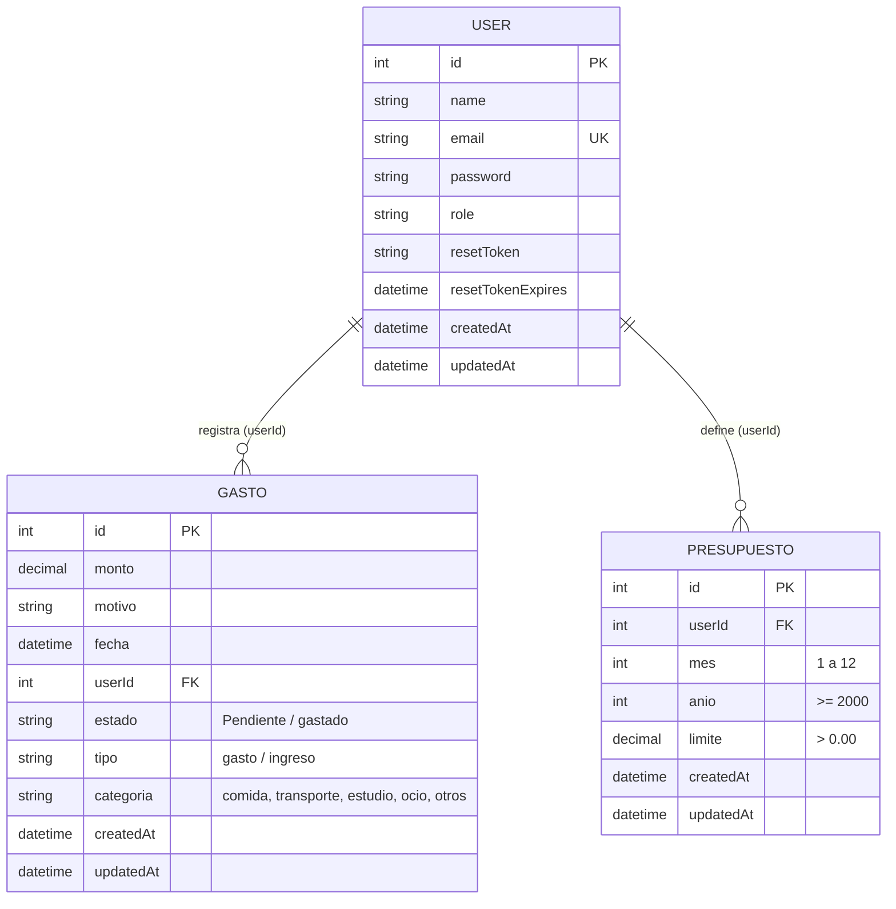

# 🎓 Presupuesto Estudiantil — Gestor Financiero para Estudiantes

[](https://nodejs.org/)
[](https://react.dev/)
[](https://www.typescriptlang.org/)
[](https://www.postgresql.org/)
[](https://expressjs.com/)
[](https://jestjs.io/)
[](https://vitejs.dev/)

Sistema integral para el control de presupuestos mensuales, registro de movimientos financieros (gastos e ingresos), liquidación de compromisos de pago e historial analítico con optimizaciones ergonómicas y de Interacción Humano-Computador (HCI).

Proyecto desarrollado para el curso **Interacción Hombre-Computador (IHC)** — Universidad.

---

## 📋 Tabla de Contenidos

- [Características Principales](#-características-principales)
- [Arquitectura del Sistema](#-arquitectura-del-sistema)
- [Estructura del Proyecto](#-estructura-del-proyecto)
- [Tecnologías Utilizadas](#-tecnologías-utilizadas)
- [Base de Datos y Modelado](#-base-de-datos-y-modelado)
- [Requisitos Previos](#-requisitos-previos)
- [Instalación y Configuración](#-instalación-y-configuración)
  - [1. Clonar el Repositorio](#1-clonar-el-repositorio)
  - [2. Configuración de Base de Datos](#2-configuración-de-base-de-datos)
  - [3. Configuración del Backend](#3-configuración-del-backend)
  - [4. Configuración del Frontend](#4-configuración-del-frontend)
- [Ejecución del Proyecto](#-ejecución-del-proyecto)
- [Pruebas Automatizadas (Testing)](#-pruebas-automatizadas-testing)
- [Referencia de Endpoints de la API](#-referencia-de-endpoints-de-la-api)
- [Decisiones de Interacción Humano-Computador (HCI)](#-decisiones-de-interacción-humano-computador-hci)
- [Autores y Créditos](#-autores-y-créditos)

---

## 🚀 Características Principales

- **Autenticación y Seguridad:** Registro, inicio de sesión mediante JSON Web Tokens (JWT), contraseñas encriptadas con `bcrypt` y recuperación de contraseña vía tokens temporales.
- **Límites Presupuestarios Dinámicos:** Definición de presupuestos por mes y año con bloqueo inteligente si un gasto supera el presupuesto restante o si se intenta definir un límite menor a lo gastado.
- **Gestión de Movimientos:** Registro, categorización (comida, transporte, estudio, ocio, otros), tipificación (gasto / ingreso) y edición de transacciones.
- **Gestión de Pagos Pendientes:** Seguimiento de deudas y compromisos con cambio de estado de `pendiente` a `gastado` con control estricto de propiedad (prevención de manipulación de registros ajenos).
- **Historial Ergonómico:** Consulta de movimientos del mes con filtros rápidos y diseño optimizado según las leyes de Fitts, Hick y reducción de carga cognitiva.

---

## 🏗 Arquitectura del Sistema

El proyecto sigue una arquitectura desacoplada **Cliente-Servidor (SPA + REST API)** respaldada por una base de datos relacional:



### Flujo de Información:
1. **Frontend:** Consume endpoints REST usando `fetch` o `axios` enviando el token `Bearer` almacenado en `localStorage`.
2. **Backend:** El middleware `authenticateToken` valida la firma del JWT e inyecta la identidad del usuario (`req.user`) en las solicitudes.
3. **Controladores:** Aplican reglas de negocio (ej. autorización de acceso al recurso, validación de presupuesto disponible) y consultan la base de datos vía Sequelize.
4. **Base de Datos:** Almacena tablas de usuarios, presupuestos y gastos con integridad referencial.

---

## 📁 Estructura del Proyecto

```text
segundo_proyecto/
├── backend/                        # Servidor API RESTful
│   ├── .env                        # Variables de entorno (DB, JWT, etc.)
│   ├── package.json                # Dependencias y scripts de backend
│   ├── server.js                   # Punto de entrada y conexión a BD
│   ├── src/
│   │   ├── app.js                  # Configuración de Express, middlewares y rutas
│   │   ├── config/
│   │   │   └── database.js         # Instancia y conexión de Sequelize
│   │   ├── controllers/
│   │   │   ├── authController.js   # Lógica de login, registro y reset password
│   │   │   ├── gastoController.js  # CRUD, filtros, liquidación y estados
│   │   │   └── presupuestoController.js # Límites mensuales y balances
│   │   ├── middleware/
│   │   │   └── authMiddleware.js   # Verificación y decodificación de JWT
│   │   ├── models/
│   │   │   ├── User.js             # Modelo de Usuarios
│   │   │   ├── Gasto.js            # Modelo de Gastos e Ingresos
│   │   │   └── Presupuesto.js      # Modelo de Presupuestos Mensuales
│   │   └── routes/
│   │       ├── authRoutes.js       # Rutas /api/auth
│   │       ├── gastosRoutes.js     # Rutas /api/gastos
│   │       └── presupuestoRoutes.js# Rutas /api/presupuesto
│   └── tests/                      # Pruebas unitarias con Jest
│       ├── filtradoGastos.test.js
│       ├── gastoController.test.js
│       └── presupuestoController.test.js
│
├── frontend/                       # Aplicación SPA (Single Page Application)
│   ├── package.json                # Dependencias y scripts de frontend
│   ├── vite.config.ts              # Configuración de Vite
│   ├── tsconfig.json               # Configuración de TypeScript
│   ├── index.html                  # Plantilla HTML base
│   └── src/
│       ├── App.tsx                 # Router y protección de rutas
│       ├── main.tsx                # Montaje de la aplicación React
│       ├── index.css / App.css     # Estilos globales y utilidades
│       ├── components/
│       │   └── Navbar.tsx          # Barra de navegación con accesibilidad Fitts
│       ├── pages/
│       │   ├── Home.tsx            # Portada
│       │   ├── Login.tsx           # Inicio de sesión
│       │   ├── Register.tsx        # Registro de usuarios
│       │   ├── ForgotPassword.tsx  # Solicitud de token de recuperación
│       │   ├── ResetPassword.tsx   # Cambio de contraseña con token
│       │   ├── Dashboard.tsx       # Resumen general y presupuesto
│       │   ├── Gastos.tsx          # Registro y administración de movimientos
│       │   ├── Pagos.tsx           # Lista y liquidación de pagos pendientes
│       │   └── Historial.tsx       # Historial mensual con filtros rápidos (Hick)
│       └── routes/
│           └── ProtectedRoute.tsx  # Guard de navegación para rutas privadas
│
└── docs/                           # Documentación de IHC y entregables
    ├── project-card.md             # Ficha técnica del proyecto
    ├── decisiones-interaccion.md   # Justificación ergonómica (Fitts, Hick, Carga Cognitiva)
    ├── evaluacion-heuristica.md    # Evaluación de las 10 Heurísticas de Nielsen
    ├── task-02-state-tests.md      # Informe de pruebas unitarias y transiciones de estado
    ├── registro_de_hallazgos_de_interaccion.md # Bitácora de hallazgos UX
    └── evidencias/                 # Capturas comparativas (Antes / Después)
```

---

## 🛠 Tecnologías Utilizadas

### Backend
- **Node.js** & **Express 5.2.1** — Entorno de ejecución y framework HTTP de alto rendimiento.
- **PostgreSQL** & **Sequelize 6.37.8** — Base de datos relacional y ORM para modelado y migraciones automáticas.
- **bcrypt 6.0.0** — Encriptado unidireccional con salt para contraseñas.
- **jsonwebtoken 9.0.3** — Generación y validación de tokens de sesión JWT.
- **CORS** & **dotenv** — Gestión de orígenes cruzados y variables de entorno.
- **Jest 30.5.2** — Framework para pruebas unitarias con mocks.

### Frontend
- **React 19.2.8** — Biblioteca para construcción de interfaces de usuario.
- **TypeScript 6.0.2** — Tipado estático para código mantenible y seguro.
- **Vite 8.3.0** — Bundler y entorno de desarrollo ultra-rápido.
- **React Router Dom 7.18.4** — Enrutamiento del lado del cliente y rutas protegidas.
- **Oxlint** — Linter ultrarrápido para análisis de código.

---

## 🗄 Base de Datos y Modelado

El sistema utiliza **PostgreSQL** como motor relacional. Sequelize sincroniza automáticamente las tablas al iniciar el servidor (`sequelize.sync({ alter: true })`).

### Diagrama Entidad-Relación (Lógico)



### Índices y Restricciones:
- `Presupuesto`: Restricción única sobre `[userId, mes, anio]`. Cada estudiante tiene a lo sumo un presupuesto por mes.
- `User`: Restricción única en `email`.
- `Gasto`: Validación de claves foráneas con aislamiento por usuario autenticado.

---

## ⚙ Requisitos Previos

Asegúrate de contar con las siguientes herramientas instaladas:

- **Node.js** (v18.0.0 o superior) — [Descargar Node.js](https://nodejs.org/)
- **npm** (v9.0.0 o superior, viene con Node)
- **PostgreSQL** (v14.0 o superior) y servicio en ejecución en el puerto `5432` — [Descargar PostgreSQL](https://www.postgresql.org/download/)
- Una herramienta para gestionar la BD (opcional): **pgAdmin 4**, **DBeaver**, o la terminal `psql`.

---

## 📦 Instalación y Configuración

### 1. Clonar el Repositorio

```bash
git clone <URL_DEL_REPOSITORIO>
cd segundo_proyecto
```

### 2. Configuración de Base de Datos

Inicia sesión en tu terminal de PostgreSQL (`psql`) o desde pgAdmin y crea la base de datos:

```sql
CREATE DATABASE presupuesto_estudiantil;
```

### 3. Configuración del Backend

1. Entra en el directorio `backend`:
   ```bash
   cd backend
   ```
2. Instala las dependencias:
   ```bash
   npm install
   ```
3. Verifica o edita el archivo de variables de entorno `.env` en `backend/.env`:
   ```env
   DB_HOST=localhost
   DB_PORT=5432
   DB_NAME=presupuesto_estudiantil
   DB_USER=postgres
   DB_PASSWORD=tu_password_de_postgres
   JWT_SECRET=mi_clave_super_secreta_jwt
   ```
   > ⚠️ **Nota:** Asegúrate de reemplazar `DB_PASSWORD` con la contraseña de tu usuario de PostgreSQL.

### 4. Configuración del Frontend

1. Abre otra terminal y entra en la carpeta `frontend`:
   ```bash
   cd frontend
   ```
2. Instala las dependencias:
   ```bash
   npm install
   ```

---

## 🚦 Ejecución del Proyecto

### Iniciar el Servidor Backend:

Desde la carpeta `backend`:
```bash
# Modo desarrollo (con recarga automática mediante nodemon):
npm run dev

# O modo producción:
npm start
```
El backend iniciará en: **`http://localhost:4000`**  
Verás en consola:
```text
PostgreSQL conectado correctamente
Modelos sincronizados correctamente
Servidor ejecutandose en http://localhost:4000
```

### Iniciar la Aplicación Frontend:

Desde la carpeta `frontend`:
```bash
npm run dev
```
Vite iniciará la aplicación en: **`http://localhost:5173`** (o el puerto mostrado en la terminal).

Abre tu navegador en `http://localhost:5173` para interactuar con la plataforma.

---

## 🧪 Pruebas Automatizadas (Testing)

El backend cuenta con **20 pruebas unitarias** implementadas con **Jest**, cubriendo lógica de negocio, validaciones y reglas de autorización:

```bash
cd backend
npm test
```

### Cobertura de las Pruebas:

| Suite de Pruebas | Archivo | Casos Evaluados |
| :--- | :--- | :--- |
| **Controlador de Gastos y Estados** | `backend/tests/gastoController.test.js` | • Transición de estado de `pendiente` a `gastado`<br>• Manejo de error 404 (gasto inexistente)<br>• Manejo de error 500 (fallos en BD)<br>• Uso correcto de parámetros de ruta (`id`)<br>• **Control de acceso 403 (rechazo de pago de gastos ajenos)**<br>• Registro, edición, eliminación y consulta mensual |
| **Controlador de Presupuesto** | `backend/tests/presupuestoController.test.js` | • Creación de presupuesto con límite mayor a cero<br>• Rechazo si el límite es menor a lo ya gastado en el mes<br>• Validación contra valores negativos, nulos o cero<br>• Bloqueo al registrar gasto si supera el presupuesto del mes |
| **Filtrado y Búsqueda** | `backend/tests/filtradoGastos.test.js` | • Filtro multicriterio (tipo, categoría, estado, fecha)<br>• Cálculo acumulado de totales y cantidad<br>• Respuesta adecuada ante búsquedas sin resultados (vacío y total 0) |

**Resultado de ejecución:**
```text
Test Suites: 3 passed, 3 total
Tests:       20 passed, 20 total
Snapshots:   0 total
Time:        ~2.5 s
Ran all test suites.
```

---

## 🔌 Referencia de Endpoints de la API

Base URL: `http://localhost:4000/api`

### 🔑 Autenticación (`/api/auth`)

| Método | Endpoint | Requiere Auth | Descripción |
| :--- | :--- | :---: | :--- |
| `POST` | `/api/auth/register` | No | Registra un nuevo usuario (`name`, `email`, `password`) |
| `POST` | `/api/auth/login` | No | Inicia sesión y retorna JWT token |
| `POST` | `/api/auth/forgot-password`| No | Genera token temporal de recuperación de contraseña |
| `POST` | `/api/auth/reset-password` | No | Establece nueva contraseña usando token |
| `GET`  | `/api/auth/me` | Sí | Obtiene los datos del perfil autenticado |

### 💰 Gastos y Movimientos (`/api/gastos`)

| Método | Endpoint | Requiere Auth | Descripción |
| :--- | :--- | :---: | :--- |
| `POST` | `/api/gastos/registrar` | Sí | Registra un nuevo movimiento (`monto`, `motivo`, `tipo`, `categoria`) |
| `GET`  | `/api/gastos/obtener` | Sí | Obtiene todos los gastos del usuario autenticado |
| `GET`  | `/api/gastos/filtrar` | Sí | Filtra por término, categoría, tipo, estado y período |
| `GET`  | `/api/gastos/historial-mes` | Sí | Obtiene movimientos y acumulados del mes actual |
| `PUT`  | `/api/gastos/editar/:id` | Sí | Edita un gasto existente del usuario |
| `DELETE`| `/api/gastos/eliminar/:id`| Sí | Elimina un gasto del usuario |
| `PUT`  | `/api/gastos/pagar/:id` | Sí | Cambia estado de `pendiente` a `gastado` (valida propietario) |

### 📊 Presupuesto (`/api/presupuesto`)

| Método | Endpoint | Requiere Auth | Descripción |
| :--- | :--- | :---: | :--- |
| `POST` | `/api/presupuesto/establecer`| Sí | Configura o actualiza el límite mensual (`limite`, `mes`, `anio`) |
| `GET`  | `/api/presupuesto/obtener` | Sí | Consulta el presupuesto del mes/año especificado |

---

## 🧠 Decisiones de Interacción Humano-Computador (HCI)

El diseño de la interfaz y la experiencia de usuario se fundamentaron en estándares de accesibilidad y psicología cognitiva:

1. **Ley de Fitts ($T = a + b \log_2(2D/W)$):**
   - El enlace de acceso a **Historial** en la barra superior cuenta con un área táctil mínima de **$44\text{px}$** (`minHeight: 44px`), garantizando un objetivo fácil y rápido de pulsar desde cualquier dispositivo.
2. **Ley de Hick ($T = b \log_2(n + 1)$):**
   - Reducción de la sobrecarga de decisiones en la pantalla de historial mediante **3 pestañas rápidas y mutuamente excluyentes** (`Todos`, `Solo Gastos`, `Solo Ingresos`), eliminando selectores redundantes anidados.
3. **Carga Cognitiva y Heurísticas de Nielsen:**
   - **H1 (Visibilidad del estado):** Notificaciones claras de éxito y alertas visuales tras registrar o pagar gastos.
   - **H2 (Correspondencia con el mundo real):** Terminología estandarizada y badges de estado descriptivos (`Pendiente`, `Pagado`).
   - **H3 (Control del usuario):** Modales de confirmación para acciones destructivas o cambios drásticos de presupuesto.
   - **H5 (Prevención de errores):** Validación en tiempo real de importes positivos y descripciones no numéricas.

Para profundizar en el análisis ergonómico, consulta la carpeta [`docs/`](docs/).

---

## 👨‍💻 Autores y Créditos

- **Estudiante / Desarrollador:** Guzman Montalvan Marcos Lehonti
- **Asignatura:** Interacción Hombre-Computador (IHC)
- **Repositorio:** `MarcosLehonti/ihc_segundo_proyecto`
