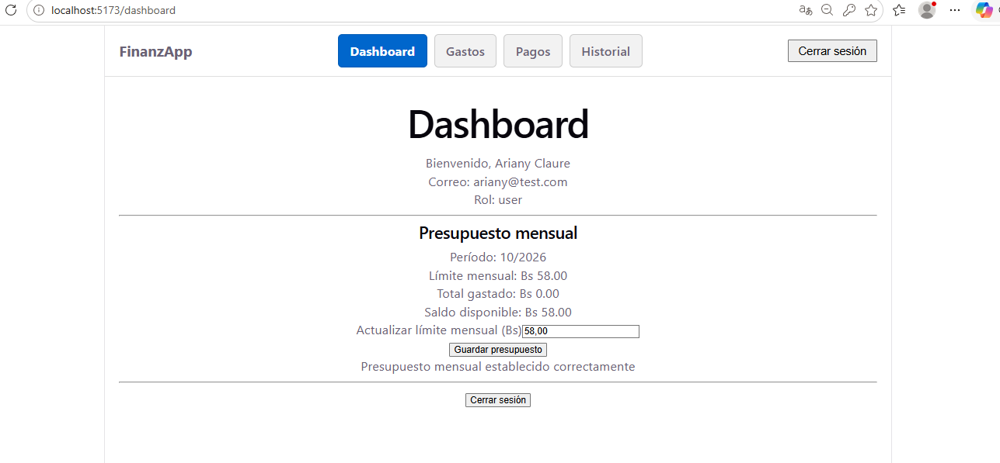

# Clase 17 · Análisis del proyecto recibido

## Proyecto recibido

- **Nombre**: Presupuesto Estudiantil (una app para registrar gastos mensuales y controlarlos con un límite).
- **Grupo anterior**: Guzman Montalvan Marcos Lehonti
- **Enlace al repositorio**: _(a completar con la URL de GitHub)_
- **Modalidad original**: hecho **sin IA**.
- **Stack**:
  - Frontend: **React 19 + TypeScript + Vite**, con `react-router-dom` para la navegación ([frontend/package.json](../frontend/package.json)).
  - Backend: **Node.js + Express 5**, autenticación con **JWT** (`jsonwebtoken`), hash de contraseñas con `bcrypt`, ORM **Sequelize** ([backend/package.json](../backend/package.json)).
  - Base de datos: **PostgreSQL**, conectada por Sequelize en [backend/src/config/database.js](../backend/src/config/database.js). Al arrancar hace `sequelize.sync({ alter: true })` ([backend/server.js:14](../backend/server.js#L14)), así que crea/ajusta las tablas automáticamente a partir de los modelos.
- **Conexión**: el frontend hace `fetch` directo contra `http://localhost:4000/api/...` (URL hardcodeada en los componentes, p. ej. [frontend/src/pages/Dashboard.tsx:49](../frontend/src/pages/Dashboard.tsx#L49)), y manda el token JWT en el header `Authorization: Bearer <token>`.

## Ejecución

El proyecto no trae un `README` general ni un `.env.example`. Las claves de entorno del `.env` del backend se deducen de [backend/src/config/database.js:4-9](../backend/src/config/database.js#L4-L9) y del middleware JWT ([backend/src/middleware/authMiddleware.js:9](../backend/src/middleware/authMiddleware.js#L9)):

```
DB_NAME=<nombre_de_la_base>
DB_USER=<usuario_postgres>
DB_PASSWORD=<password_postgres>
DB_HOST=localhost
DB_PORT=5432
JWT_SECRET=<cadena_cualquiera>
```

Comandos usados, en orden:

```bash
# 1) Backend (puerto 4000)
cd backend
npm install
npm run dev
```

```bash
# 2) Frontend (puerto 5173 por defecto)
cd frontend
npm install
npm run dev
```

No hay script de migración: Sequelize crea las tablas (`Users`, `Gastos`, `Presupuestos`) al iniciar el backend por `sync({ alter: true })` ([backend/server.js:14](../backend/server.js#L14)).



### Pruebas

Sí tiene pruebas automatizadas en el backend, con **Jest**. Están en [backend/tests/](../backend/tests/):

- [backend/tests/presupuestoController.test.js](../backend/tests/presupuestoController.test.js) — cubre `establecerPresupuesto` (happy path, límite menor que lo gastado, límite en cero) y la regla de límite mensual al registrar gasto.
- [backend/tests/gastoController.test.js](../backend/tests/gastoController.test.js)
- [backend/tests/filtradoGastos.test.js](../backend/tests/filtradoGastos.test.js)

Para correrlas:

```bash
cd backend
npm test
```

Resultado real al correrlas en este análisis:

```
> backend@1.0.0 test
> jest

Test Suites: 3 passed, 3 total
Tests:       20 passed, 20 total
Snapshots:   0 total
Time:        1.907 s
Ran all test suites.
```

El frontend **no tiene** pruebas automatizadas (no define `scripts.test` en [frontend/package.json](../frontend/package.json); solo `dev`, `build`, `lint` con `oxlint` y `preview`).

### Usuario de prueba para entrar al Dashboard

El proyecto **no trae seeds ni usuarios de prueba** (la tabla `Users` quedó vacía después del `sync` inicial). Para entrar al Dashboard hay que **registrarse desde la propia app**:

1. En http://localhost:5173/ ir a **Registrarse**.
2. Completar nombre, email y una contraseña cualquiera (el backend hace `POST /api/auth/register` y lo deja logueado automáticamente, [frontend/src/pages/Register.tsx:14-50](../frontend/src/pages/Register.tsx#L14-L50)).
3. El token JWT se guarda en `localStorage` y la app redirige al **Dashboard**, donde ya se puede probar "Guardar presupuesto".

## Recorrido: pantalla → acción → regla → datos

### Acción principal: Dashboard → "Guardar presupuesto"

| Paso | Qué pasa | Archivo:líneas |
|------|----------|----------------|
| 1 | El usuario ingresa el monto en el input "Establecer / Actualizar límite mensual (Bs)" y pulsa el botón **Guardar presupuesto**. | [frontend/src/pages/Dashboard.tsx:227-249](../frontend/src/pages/Dashboard.tsx#L227-L249) |
| 2 | El submit del `<form>` dispara `handleGuardarPresupuesto(event)`. | [frontend/src/pages/Dashboard.tsx:116-119](../frontend/src/pages/Dashboard.tsx#L116-L119) |
| 3 | **Validación cliente 1**: límite finito y > 0. Si no, muestra el error "El límite mensual debe ser mayor que cero". | [frontend/src/pages/Dashboard.tsx:123-128](../frontend/src/pages/Dashboard.tsx#L123-L128) |
| 4 | **Validación cliente 2**: si ya hay resumen cargado, el nuevo límite no puede ser menor que lo ya gastado en el mes. | [frontend/src/pages/Dashboard.tsx:130-133](../frontend/src/pages/Dashboard.tsx#L130-L133) |
| 5 | Si ya existía un presupuesto, pide confirmación con `window.confirm` antes de reemplazarlo. | [frontend/src/pages/Dashboard.tsx:135-140](../frontend/src/pages/Dashboard.tsx#L135-L140) |
| 6 | Toma el `token` del `localStorage`; si no hay, redirige a `/login`. | [frontend/src/pages/Dashboard.tsx:142-147](../frontend/src/pages/Dashboard.tsx#L142-L147) |
| 7 | **Llamada HTTP**: `POST http://localhost:4000/api/presupuesto/establecer` con body `{ limite, mes, anio }` y header `Authorization: Bearer <token>`. | [frontend/src/pages/Dashboard.tsx:150-164](../frontend/src/pages/Dashboard.tsx#L150-L164) |
| 8 | **Ruta backend**: `router.post('/establecer', authenticateToken, establecerPresupuesto)`. | [backend/src/routes/presupuestoRoutes.js:10](../backend/src/routes/presupuestoRoutes.js#L10) |
| 9 | **Middleware** `authenticateToken` valida el JWT con `JWT_SECRET` y pone `req.user`. Si falta → 401; si es inválido → 403. | [backend/src/middleware/authMiddleware.js:3-14](../backend/src/middleware/authMiddleware.js#L3-L14) |
| 10 | **Validación servidor**: `limite` positivo y finito, `mes` entero entre 1 y 12, `anio` entero ≥ 2000. Si no se cumple → 400. | [backend/src/controllers/presupuestoController.js:10-23](../backend/src/controllers/presupuestoController.js#L10-L23) |
| 11 | **Consulta a datos (gastos del mes)**: `Gasto.findAll` filtrando `userId` y `fecha` en `[inicio del mes, inicio del mes siguiente)`. | [backend/src/controllers/presupuestoController.js:25-37](../backend/src/controllers/presupuestoController.js#L25-L37) |
| 12 | **Cálculo**: `gastado = suma(gastos.monto)` con `reduce`. | [backend/src/controllers/presupuestoController.js:39-42](../backend/src/controllers/presupuestoController.js#L39-L42) |
| 13 | **Regla de negocio**: si `limite < gastado` → 400 "El límite no puede ser menor que lo que ya has gastado en el mes". | [backend/src/controllers/presupuestoController.js:44-48](../backend/src/controllers/presupuestoController.js#L44-L48) |
| 14 | **Upsert** por `(userId, mes, anio)`: si ya hay registro, actualiza `limite` con `save()`; si no, crea uno nuevo con `Presupuesto.create`. | [backend/src/controllers/presupuestoController.js:50-74](../backend/src/controllers/presupuestoController.js#L50-L74) |
| 15 | **Datos (tabla `Presupuestos`)**: columnas `id`, `userId`, `mes` (1-12), `anio` (≥2000), `limite` (`DECIMAL(10,2)`, min 0.01), con índice único `(userId, mes, anio)`. | [backend/src/models/Presupuesto.js](../backend/src/models/Presupuesto.js) |
| 16 | El backend responde `201` (creado) o `200` con el mensaje y el objeto `presupuesto`. El frontend muestra el mensaje y vuelve a llamar `cargarPresupuesto()` para refrescar la pantalla. | [frontend/src/pages/Dashboard.tsx:166-174](../frontend/src/pages/Dashboard.tsx#L166-L174) |

### Cálculo de "Total gastado" y "Saldo disponible"

| Paso | Qué pasa | Archivo:líneas |
|------|----------|----------------|
| 1 | Al cargar el Dashboard, se llama `cargarPresupuesto()`: `GET http://localhost:4000/api/presupuesto/obtener?mes=X&anio=Y` con el token. | [frontend/src/pages/Dashboard.tsx:47-56](../frontend/src/pages/Dashboard.tsx#L47-L56) |
| 2 | Ruta backend: `router.get('/obtener', authenticateToken, obtenerPresupuesto)`. | [backend/src/routes/presupuestoRoutes.js:11](../backend/src/routes/presupuestoRoutes.js#L11) |
| 3 | El controlador valida `mes` y `anio`, busca el presupuesto del usuario (`Presupuesto.findOne`); si no existe → 404. | [backend/src/controllers/presupuestoController.js:83-109](../backend/src/controllers/presupuestoController.js#L83-L109) |
| 4 | Consulta los gastos del mes con el mismo rango `[inicioMes, inicioMesSiguiente)` y suma los `monto` → `gastado`. | [backend/src/controllers/presupuestoController.js:111-128](../backend/src/controllers/presupuestoController.js#L111-L128) |
| 5 | Devuelve `{ presupuesto, gastado, disponible: limite - gastado }`, ambos redondeados a 2 decimales. | [backend/src/controllers/presupuestoController.js:130-136](../backend/src/controllers/presupuestoController.js#L130-L136) |
| 6 | El Dashboard renderiza los 3 valores: Límite mensual, Total gastado y Saldo disponible. | [frontend/src/pages/Dashboard.tsx:208-222](../frontend/src/pages/Dashboard.tsx#L208-L222) |

## Observaciones

Lo que está bien:

- Validación duplicada (cliente y servidor) del límite positivo en Dashboard y `establecerPresupuesto` ([frontend/src/pages/Dashboard.tsx:125-128](../frontend/src/pages/Dashboard.tsx#L125-L128), [backend/src/controllers/presupuestoController.js:10-23](../backend/src/controllers/presupuestoController.js#L10-L23)).
- Regla de negocio coherente: no se permite bajar el límite por debajo de lo ya gastado ([backend/src/controllers/presupuestoController.js:44-48](../backend/src/controllers/presupuestoController.js#L44-L48)).
- Índice único `(userId, mes, anio)` a nivel modelo, que evita duplicados en base ([backend/src/models/Presupuesto.js:37-42](../backend/src/models/Presupuesto.js#L37-L42)).
- Rango mensual con `Op.gte` + `Op.lt` del mes siguiente, sin problemas de off-by-one ni de "últimos días" ([backend/src/controllers/presupuestoController.js:25-37](../backend/src/controllers/presupuestoController.js#L25-L37)).
- Todas las rutas de presupuesto exigen token JWT ([backend/src/routes/presupuestoRoutes.js:10-11](../backend/src/routes/presupuestoRoutes.js#L10-L11)).
- Hay pruebas Jest para los dos puntos críticos del dominio (límite inválido y bloqueo al superar presupuesto) en [backend/tests/presupuestoController.test.js](../backend/tests/presupuestoController.test.js).

Lo que podría fallar o conviene vigilar:

- URL del backend hardcodeada en el frontend (`http://localhost:4000`) en [frontend/src/pages/Dashboard.tsx:49](../frontend/src/pages/Dashboard.tsx#L49) y [:151](../frontend/src/pages/Dashboard.tsx#L151) (y previsiblemente en el resto de pantallas). Si cambia el host, hay que editar varios archivos.
- No existe `.env.example` ni README raíz, así que las claves de entorno hay que leerlas del código ([backend/src/config/database.js:4-9](../backend/src/config/database.js#L4-L9)) — pequeño fricción para quien levanta el proyecto por primera vez.
- `sequelize.sync({ alter: true })` en [backend/server.js:14](../backend/server.js#L14) ajusta el esquema en cada arranque. Es cómodo en desarrollo pero riesgoso si llegara a producción.
- Ruta raíz `/` responde "Bienvenido a la API de TruequeU" en [backend/src/app.js:14-16](../backend/src/app.js#L14-L16): leftover del nombre de otro proyecto. Es solo cosmético, pero conviene saberlo.
- `obtenerGastos` ([backend/src/controllers/gastoController.js:102-114](../backend/src/controllers/gastoController.js#L102-L114)) devuelve **todos** los gastos del usuario sin filtro de fecha, mientras que `obtenerHistorialMesActual` ([backend/src/controllers/gastoController.js:393-419](../backend/src/controllers/gastoController.js#L393-L419)) sí filtra al mes actual. Son dos endpoints distintos; no es un bug pero puede confundir si no se recuerda cuál se está usando.
- La confirmación al actualizar el límite se hace con `window.confirm` ([frontend/src/pages/Dashboard.tsx:136-140](../frontend/src/pages/Dashboard.tsx#L136-L140)). Funciona y respeta el estilo simple del proyecto; es solo algo a tener en cuenta si Tarea 5 pide mejoras de interacción en ese flujo.
- No hay pruebas automatizadas en el frontend.

## Impacto para la Tarea 5

Mientras no tengamos la consigna formal de la Tarea 5, lo que ya se puede anticipar:

- **Qué se mantiene igual (respetamos el método del grupo anterior)**:
  - Stack: React + TS + Vite (frontend), Express + Sequelize + Postgres (backend).
  - Convenciones: controladores en `backend/src/controllers/`, rutas en `backend/src/routes/`, modelos en `backend/src/models/`; páginas planas en `frontend/src/pages/`; estilo simple, sin librerías de UI ni state manager, `fetch` directo.
  - Autenticación por JWT en header `Authorization: Bearer`.
  - Reglas de negocio existentes: validación de límite positivo y de que el límite no baje del gastado.

- **Qué partes son fáciles de extender** (siguiendo el mismo patrón):
  - Agregar nuevos filtros al historial: ya existe `filtrarGastos` ([backend/src/controllers/gastoController.js:291-391](../backend/src/controllers/gastoController.js#L291-L391)) con `buscar`, `tipo`, `categoria`, `estado`, `periodo`, `desde`, `hasta`.
  - Agregar nuevos campos al modelo `Gasto` (ya tiene `tipo` y `categoria` como strings libres).
  - Agregar nuevas pantallas: basta con copiar el patrón de una página existente y registrarla en `frontend/src/routes/`.

- **Qué partes son más difíciles de extender**:
  - Cambiar la base URL del backend: hay que tocar cada `fetch` en las páginas (está hardcodeada).
  - Introducir conceptos nuevos de dominio (p. ej. compartir presupuesto entre varios usuarios, metas de ahorro, multi-moneda): requiere nuevos modelos, nuevas migraciones y repensar la clave única `(userId, mes, anio)`.
  - Hacer la UI responsive o accesible: casi no hay CSS propio, el markup es muy plano.

- **Qué archivos habría que crear o cambiar en una extensión típica** (por ejemplo, un historial que compare meses):
  - Backend: nuevo método en [backend/src/controllers/gastoController.js](../backend/src/controllers/gastoController.js) y su ruta en [backend/src/routes/gastosRoutes.js](../backend/src/routes/gastosRoutes.js).
  - Frontend: nueva página en `frontend/src/pages/` + entrada en `frontend/src/routes/`.
  - Prueba Jest en `backend/tests/`.

- **Qué pruebas conviene escribir ANTES de refactorizar algo**:
  1. Caso de **actualización** de presupuesto (hoy los tests solo cubren creación): verificar que la segunda llamada a `establecerPresupuesto` para el mismo `(userId, mes, anio)` **no** crea un segundo registro sino que llama a `save()` ([backend/src/controllers/presupuestoController.js:50-62](../backend/src/controllers/presupuestoController.js#L50-L62)).
  2. Validación de `mes`/`anio` fuera de rango (hoy el test solo cubre `limite: 0`).
  3. Cálculo de `disponible` en `obtenerPresupuesto` cuando no hay gastos ⇒ `disponible === limite` ([backend/src/controllers/presupuestoController.js:130-136](../backend/src/controllers/presupuestoController.js#L130-L136)).
  4. Comportamiento de `authenticateToken` con token ausente / inválido en la ruta de presupuesto.
  5. Si se tocaran los `fetch` del frontend (por ejemplo, moverlos a una base URL única), vale la pena agregar antes al menos un test de la lógica de validación de `handleGuardarPresupuesto` ([frontend/src/pages/Dashboard.tsx:116-179](../frontend/src/pages/Dashboard.tsx#L116-L179)) con alguna herramienta de testing de React.

- **Riesgos**:
  - Cualquier cambio en `sequelize.sync({ alter: true })` o en los modelos puede alterar las tablas en la base real al próximo arranque.
  - El índice único `(userId, mes, anio)` significa que renombrar/renumerar meses rompería datos existentes.
  - Si se toca `fetch` o el token en una página, es fácil olvidar otra: no hay un cliente HTTP centralizado.

## Impacto · Tarea 5 (Presupuesto por categoría)

**Consigna**: crear un presupuesto mensual **por categoría** y mostrar cuánto se consumió. Debe persistir después de recargar o volver a entrar.

### Estado actual (lo que ya existe)

- Las **categorías** no son una tabla: son un **string** dentro de cada gasto (`Gasto.categoria`, `DataTypes.STRING`, default `'otros'`, [backend/src/models/Gasto.js:36-40](../backend/src/models/Gasto.js#L36-L40)). El frontend ofrece 4 valores fijos en un `<select>`: `otros`, `comida`, `transporte`, `estudio` ([frontend/src/pages/Gastos.tsx:300-305](../frontend/src/pages/Gastos.tsx#L300-L305)). El controlador normaliza a minúsculas y `.trim()` al registrar y editar ([backend/src/controllers/gastoController.js:89](../backend/src/controllers/gastoController.js#L89), [:239](../backend/src/controllers/gastoController.js#L239)).
- El **presupuesto actual** es solo mensual: tabla `Presupuestos` con `(userId, mes, anio, limite)`, único por `(userId, mes, anio)` ([backend/src/models/Presupuesto.js](../backend/src/models/Presupuesto.js)).
- El **Dashboard** muestra Límite / Total gastado / Saldo disponible del mes y permite crear o actualizar el límite mensual ([frontend/src/pages/Dashboard.tsx:204-253](../frontend/src/pages/Dashboard.tsx#L204-L253)).

### Interfaz

- Dónde: en el mismo **Dashboard.tsx**, **debajo** de la sección "Presupuesto mensual" existente, agregar una sección "Presupuesto por categoría" con el mismo estilo plano (sin CSS nuevo, sin librería de UI).
- Qué muestra: por cada categoría conocida (las 4 fijas: `otros`, `comida`, `transporte`, `estudio`), una fila con **Categoría · Límite · Consumido · Restante**. Si la categoría no tiene presupuesto, se muestra "—" en Límite/Restante y solo el Consumido real.
- Formulario chico (al final de la sección): un `<select>` de categoría (los mismos 4 valores) + input de monto (`type="number"`, `min="0.01"`, `step="0.01"`) + botón **Guardar**. Al enviar, hace `POST /api/presupuesto-categoria/establecer`.
- Mensajes: usa los mismos `<p role="status">` / `<p role="alert">` que ya usa el Dashboard para éxito/error.

### Lógica

Reglas, siguiendo el mismo patrón de `establecerPresupuesto` ([backend/src/controllers/presupuestoController.js:5-81](../backend/src/controllers/presupuestoController.js#L5-L81)):

1. `limite` debe ser finito y mayor a 0.
2. `categoria` requerida (string no vacío); se normaliza a minúsculas y `.trim()` antes de guardar.
3. `categoria` **debe ser una de las 4 fijas**: `otros`, `comida`, `transporte`, `estudio` (las mismas del `<select>` en [frontend/src/pages/Gastos.tsx:300-305](../frontend/src/pages/Gastos.tsx#L300-L305)). Si no está en la lista → `400`. La lista queda como constante en el controlador (`const CATEGORIAS_VALIDAS = ['otros', 'comida', 'transporte', 'estudio']`) para que cualquier cambio futuro sea un solo lugar.
4. `mes` entero 1-12; `anio` entero ≥ 2000.
5. El `limite` **no puede ser menor** que lo ya **consumido en esa categoría** durante ese mes (sumatoria de `Gasto.monto` con `userId = req.user.id`, `categoria = X`, `fecha ∈ [inicioMes, inicioMesSiguiente)`).
6. Si ya existe un registro para `(userId, categoria, mes, anio)` → actualiza con `.save()`; si no → `.create()`.
7. **Consumido** = `SUM(Gasto.monto)` filtrado por `userId`, `categoria` y rango mensual, usando `Op.gte` / `Op.lt` como ya se hace para el mensual.

**Decisión sobre la suma de límites por categoría vs. límite mensual** (lo que pide la consigna):

- **Recomendación**: *permitir* que la suma de los límites por categoría pueda **superar** el límite mensual general, **sin** validación cruzada que lo bloquee.
- **Por qué se permite**:
  1. **El bloqueo real sigue siendo el mensual**. El control que impide gastar de más ya existe en `registrarGasto` ([backend/src/controllers/gastoController.js:68-80](../backend/src/controllers/gastoController.js#L68-L80)): si el gasto hace que el total del mes supere el límite mensual, lo rechaza con `400`. El presupuesto por categoría es *informativo* (ver cuánto se consumió en cada rubro), no un segundo portón que haya que cruzar. Entonces no hace falta que la suma por categoría se pegue al mensual: con que el gasto no supere el mensual alcanza.
  2. **Simplicidad del controlador**. Cada endpoint hace una sola validación de dominio, igual que `establecerPresupuesto`. Agregar validación cruzada rompe ese patrón.
  3. **Evita cascadas**. Si forzáramos `sum(límites_categoría) ≤ límite_mensual`, bajar el mensual podría volver inválidos varios por-categoría ya guardados, y habría que elegir cuál ajustar (o rechazar la bajada del mensual). Más código, más fricción y más tests para una regla que no agrega poder real.
- **Alternativa estricta** (si el docente la prefiere): el POST a `/api/presupuesto-categoria/establecer` devolvería `400` cuando `sum(limites_otras_categorias_del_mes) + nuevo_limite > limite_mensual_del_mes`. Haría falta además revisar qué pasa cuando no existe presupuesto mensual (¿se bloquea el por-categoría también?) y una validación cruzada inversa en `establecerPresupuesto` para evitar bajar el mensual por debajo de la suma de categorías. Queda documentado por si lo piden.

**No se toca** `registrarGasto` ni el presupuesto mensual: la nueva relación es *aditiva*. Esto evita romper los 20 tests que ya pasan.

### Datos

Nueva relación (mismo ORM, Sequelize, mismo estilo que `Presupuesto.js`):

- Archivo nuevo: `backend/src/models/PresupuestoCategoria.js`.
- Columnas:
  - `id` INTEGER autoIncrement primaryKey
  - `userId` INTEGER notNull
  - `categoria` STRING notNull
  - `mes` INTEGER notNull, validate `min: 1, max: 12`
  - `anio` INTEGER notNull, validate `min: 2000`
  - `limite` DECIMAL(10,2) notNull, validate `min: 0.01`
- Índice único: `['userId', 'categoria', 'mes', 'anio']` (misma forma del índice único de `Presupuesto.js:37-42`).
- La creación de la tabla la hace automáticamente `sequelize.sync({ alter: true })` en [backend/server.js:14](../backend/server.js#L14) la próxima vez que arranque el backend (igual que `Presupuestos` hoy). Hay que registrar el modelo haciendo `require` en `app.js` o `server.js` para que Sequelize lo conozca al momento del `sync`.
- **Consumido** = `Gasto.findAll({ where: { userId, categoria, fecha: [inicioMes, inicioMesSiguiente) } }).reduce(... monto)`. Mismo cálculo y mismo rango que el mensual, solo que con un filtro extra por `categoria`.

### Pruebas

Mismo runner que ya existe: **Jest** con mocks de los modelos (`jest.mock('../src/models/...')`), siguiendo el estilo de [backend/tests/presupuestoController.test.js](../backend/tests/presupuestoController.test.js). Nuevo archivo: `backend/tests/presupuestoCategoriaController.test.js`.

Casos a cubrir (7):

1. **Válido**: `(limite: 300, categoria: 'comida', mes: 11, anio: 2026)` con `Gasto.findAll` mockeado a `[{ monto: 50 }]` → `201` + "Presupuesto por categoría establecido correctamente".
2. **Inválido (limite ≤ 0 o faltan datos numéricos)** → `400` "Debes proporcionar una categoría, un límite positivo, un mes válido y un año válido".
3. **Categoría fuera de la lista fija**: `(categoria: 'viajes')` → `400` "La categoría debe ser una de: otros, comida, transporte, estudio". `Presupuesto.create` **no** debe llamarse.
4. **Menor a lo ya consumido**: `limite: 100` con gastos de esa categoría por `200` → `400` "El límite no puede ser menor que lo que ya has gastado en esa categoría".
5. **Cálculo del consumido en GET**: `obtenerPresupuestoCategoria(mes, anio, categoria)` con `Gasto.findAll` mockeado → responde `{ presupuesto, consumido, restante }` correctos.
6. **Aislamiento por usuario**: verificar que el `where` de `findOne`/`findAll` incluye `userId = req.user.id` (otro usuario con los mismos `(categoria, mes, anio)` no debe ver el registro).
7. **Upsert**: segunda llamada con mismo `(userId, categoria, mes, anio)` llama a `.save()` y no crea un segundo registro.

Correrlas con `cd backend && npm test`.

### Contrato de las rutas nuevas (para dividir el trabajo)

Mismo estilo de nombres y shape de respuesta que `/api/presupuesto/establecer` y `/api/presupuesto/obtener`. Ambas rutas requieren `authMiddleware` (header `Authorization: Bearer <token>`). Prefijo: **`/api/presupuesto-categoria`** (archivo nuevo `backend/src/routes/presupuestoCategoriaRoutes.js`, montado en `app.js` como `app.use('/api/presupuesto-categoria', presupuestoCategoriaRoutes)`).

#### 1) `POST /api/presupuesto-categoria/establecer`

Crea o actualiza (upsert por `(userId, categoria, mes, anio)`).

- **Headers**: `Authorization: Bearer <token>`, `Content-Type: application/json`
- **Body**:
  ```json
  { "categoria": "comida", "limite": 300, "mes": 11, "anio": 2026 }
  ```
- **Respuesta OK**:
  - `201 Created` cuando crea:
    ```json
    {
      "message": "Presupuesto por categoría establecido correctamente",
      "presupuesto": { "id": 1, "userId": 1, "categoria": "comida", "mes": 11, "anio": 2026, "limite": 300 }
    }
    ```
  - `200 OK` cuando actualiza:
    ```json
    {
      "message": "Presupuesto por categoría actualizado correctamente",
      "presupuesto": { "id": 1, "userId": 1, "categoria": "comida", "mes": 11, "anio": 2026, "limite": 350 }
    }
    ```
- **Errores**:
  - `400` `{ "error": "Debes proporcionar una categoría, un límite positivo, un mes válido y un año válido" }` (datos faltantes o fuera de rango).
  - `400` `{ "error": "La categoría debe ser una de: otros, comida, transporte, estudio" }` (categoría no está en la lista fija).
  - `400` `{ "error": "El límite no puede ser menor que lo que ya has gastado en esa categoría" }`.
  - `401` / `403` si el token falta o es inválido (lo pone `authMiddleware`).
  - `500` `{ "error": "Error al establecer el presupuesto por categoría" }`.

#### 2) `GET /api/presupuesto-categoria/obtener?mes=M&anio=A`

Devuelve el **listado** por las 4 categorías fijas con límite / consumido / restante del usuario del token.

- **Headers**: `Authorization: Bearer <token>`
- **Query**: `?mes=11&anio=2026`
- **Respuesta OK (`200`)**:
  ```json
  {
    "mes": 11,
    "anio": 2026,
    "categorias": [
      { "categoria": "otros",      "limite": null, "consumido": 0,   "restante": null },
      { "categoria": "comida",     "limite": 300,  "consumido": 120, "restante": 180 },
      { "categoria": "transporte", "limite": 150,  "consumido": 50,  "restante": 100 },
      { "categoria": "estudio",    "limite": null, "consumido": 40,  "restante": null }
    ]
  }
  ```
  - `limite` y `restante` son `null` cuando no hay presupuesto definido para esa categoría (el frontend muestra "—").
  - `consumido` siempre viene (puede ser `0`), con 2 decimales.
- **Errores**:
  - `400` `{ "error": "Debes indicar un mes y un año válidos" }`.
  - `401` / `403` si el token falta o es inválido.
  - `500` `{ "error": "Error al consultar los presupuestos por categoría" }`.

> El GET devuelve **siempre** las 4 categorías aunque no haya ningún registro guardado: así el frontend no tiene que hacer merge en el cliente ni manejar casos "vacíos" distintos.

### Riesgos

- **`sync({ alter: true })` real** ([backend/server.js:14](../backend/server.js#L14)): al agregar un modelo nuevo, Sequelize creará la tabla al próximo arranque. En desarrollo es cómodo; si la base está compartida hay que avisar al equipo. No afecta a `Gastos` ni a `Presupuestos` existentes.
- **Categoría como string libre**: hoy el controlador de gastos la normaliza a minúsculas, pero `editarGasto` acepta cualquier string. Si alguien registra un gasto con `categoria: 'Comidas'` (plural o con mayúscula), no coincidirá con el presupuesto `'comida'` y quedará como "sin presupuesto". Mitigación: normalizar a minúsculas también en el nuevo controlador y usar la **misma lista fija** de 4 categorías en el `<select>` del Dashboard (mantiene el estilo del proyecto, no hace falta tabla `Categorías`).
- **Doble regla de bloqueo**: hoy `registrarGasto` solo bloquea contra el presupuesto *mensual*. No se cambia en esta tarea: el presupuesto por categoría es solo *informativo* en la UI. Riesgo: un usuario puede gastar más que su límite por categoría sin aviso del backend. Si el docente lo pide, se puede sumar en una iteración posterior (y haría falta un test nuevo que no rompa a los existentes).
- **Hardcode de la URL**: igual que el resto del proyecto, el nuevo `fetch` del Dashboard apuntará directo a `http://localhost:4000`. Es consistente con el método del grupo anterior.
- **Suma de límites > mensual**: documentado arriba. Si el docente lo rechaza, se agrega la validación cruzada y un test más.

## Modalidad del análisis

Proyecto original hecho **sin IA** (grupo anterior). Este análisis se hizo con apoyo de IA (Claude Code), con verificación nuestra en los archivos reales del repo.
